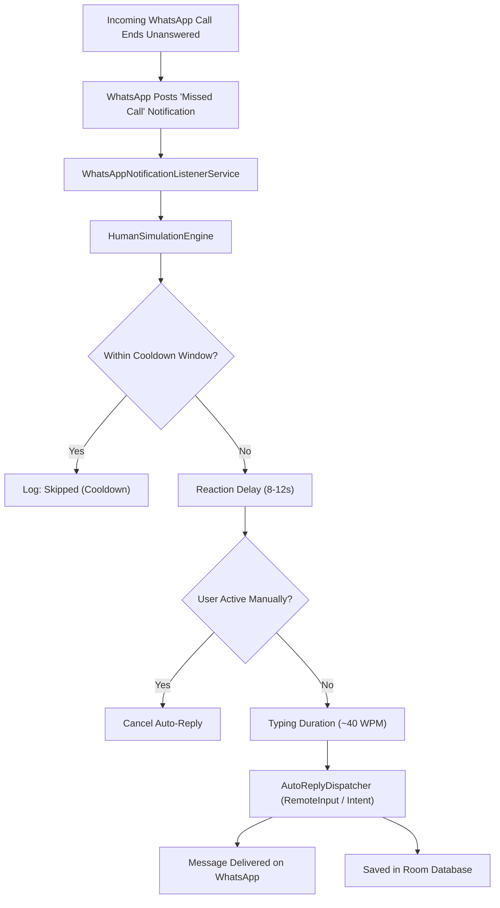

# WhatsApp Missed Call Auto-Responder 📱📞

[](https://www.android.com/)
[](https://kotlinlang.org/)
[](https://developer.android.com/jetpack/compose)
[](https://developer.android.com/training/data-storage/room)

An intelligent, self-hosted Android application that detects unanswered voice and video calls on WhatsApp (`com.whatsapp` and `com.whatsapp.w4b`) and dispatches natural, human-like automated text replies.

---

## 🌟 Why This Exists

When people call your WhatsApp and you cannot answer (e.g., during meetings, driving, or sleeping), standard automation bots either fail completely or reply instantly in 1 second. Instant bot replies can trigger account bans and feel artificial.

This application runs 100% on your Android device, uses **natural 8–12 second reaction delays**, calculates **human typing speed (~40 WPM)**, and provides a full in-app message customization dashboard.

---

## ✨ Features

- **🧠 Human Simulation & Anti-Ban Safeguards**:
  - **Randomized Reaction Jitter (8–12s)**: Deliberate pause before taking action to mimic human observation.
  - **Keystroke Speed Calculation**: Typing pause proportional to message character count (~40 Words Per Minute).
  - **Abort on Manual Activity**: Automatically cancels the scheduled reply if you pick up the phone and call back or message first.
  - **Anti-Spam Cooldown**: Prevents repeated replies if the same contact calls repeatedly within a short window.
- **💬 In-App Message Customizer**:
  - Create and manage custom auto-reply messages directly inside the app.
  - Dynamic placeholders:
    - `{name}` — Replaced with caller's WhatsApp contact name.
    - `{time}` — Replaced with the exact timestamp of the missed call (e.g. *10:15 AM*).
  - Quick presets: *In a Meeting*, *Driving*, *Sleeping*, *Custom*.
- **📊 Real-Time Audit Log**:
  - Displays every intercepted call, contact name, timestamp, reply text, and status (*REPLIED*, *COOLDOWN*, *CANCELLED*).
- **🔒 Privacy First & 100% On-Device**:
  - Zero cloud servers required. All templates and logs are stored locally in an on-device Room SQLite database.

---

## 🛠️ Tech Stack

| Layer | Technology |
| :--- | :--- |
| **Language** | Kotlin 1.9+ |
| **UI Framework** | Jetpack Compose with Material 3 Design |
| **Local Storage** | Room Database (SQLite) |
| **Background Processing** | Android `NotificationListenerService` |
| **Architecture** | MVVM + Clean Architecture + Coroutines StateFlow |
| **Target OS** | Android 8.0 (API 26) through Android 14+ (API 34) |

---

## 🏗️ Architecture



---

## 📁 Project Structure

```
D:\whatsapp-missed-call-responder\
├── app/
│   ├── src/main/
│   │   ├── AndroidManifest.xml
│   │   ├── java/com/whatsapp/callresponder/
│   │   │   ├── WhatsAppResponderApp.kt          # Application setup & notification channels
│   │   │   ├── data/local/
│   │   │   │   ├── AppDatabase.kt               # Room SQLite database
│   │   │   │   ├── entity/                      # TemplateEntity, CallLogEntity, SettingsEntity
│   │   │   │   └── dao/                         # TemplateDao, LogDao, SettingsDao
│   │   │   ├── service/
│   │   │   │   ├── WhatsAppNotificationListenerService.kt  # Notification hook
│   │   │   │   ├── HumanSimulationEngine.kt     # Delay & typing simulation engine
│   │   │   │   └── AutoReplyDispatcher.kt       # RemoteInput delivery handler
│   │   │   ├── ui/
│   │   │   │   ├── MainActivity.kt              # Bottom navigation
│   │   │   │   ├── dashboard/DashboardScreen.kt # Master switch, permissions, stats
│   │   │   │   ├── templates/TemplateEditorScreen.kt # Message customizer
│   │   │   │   ├── settings/SettingsScreen.kt   # Delay sliders & typing toggles
│   │   │   │   ├── history/HistoryScreen.kt     # Audit log
│   │   │   │   └── theme/                       # WhatsApp Material 3 theme
│   │   │   └── util/TemplateResolver.kt         # {name} and {time} tag parser
│   │   └── res/values/strings.xml
│   └── build.gradle.kts
├── docs/
│   ├── architecture.md
│   └── anti-ban.md
├── .github/
│   ├── workflows/android-ci.yml
│   ├── ISSUE_TEMPLATE/
│   └── pull_request_template.md
├── build.gradle.kts
├── settings.gradle.kts
├── gradle.properties
└── README.md
```

---

## 🚀 Installation & Setup

### Prerequisites
- Android Studio (Koala, Ladybug, or newer).
- JDK 17.
- An Android device running Android 8.0 or higher.

### Building and Running
1. Clone the repository:
   ```bash
   git clone https://github.com/learnwithansh7/whatsapp-missed-call-responder.git
   ```
2. Open the project in Android Studio.
3. Allow Gradle to synchronize dependencies.
4. Connect your phone via USB with **USB Debugging** enabled.
5. Click **Run** (`Shift + F10`) or assemble the APK via terminal:
   ```bash
   ./gradlew assembleDebug
   ```
6. On your phone, tap **"Grant Notification Access"** in the app and toggle permission for **WhatsApp Call Responder**.

---

## ❓ Troubleshooting & FAQ

- **App is not replying to missed calls**: Ensure you granted **Notification Access** in Android Settings -> Special App Access -> Notification Access.
- **Battery optimization killing the service**: In your phone's battery settings, set battery usage for WhatsApp Call Responder to **Unrestricted** so Android does not kill the listener in the background.

---

## ⚖️ Disclaimer

This project is an independent open-source utility and is not affiliated with, endorsed by, or associated with WhatsApp LLC, Meta Platforms, Inc., or any of their subsidiaries. Use responsibly and in compliance with all applicable communication laws and platform terms of service.
