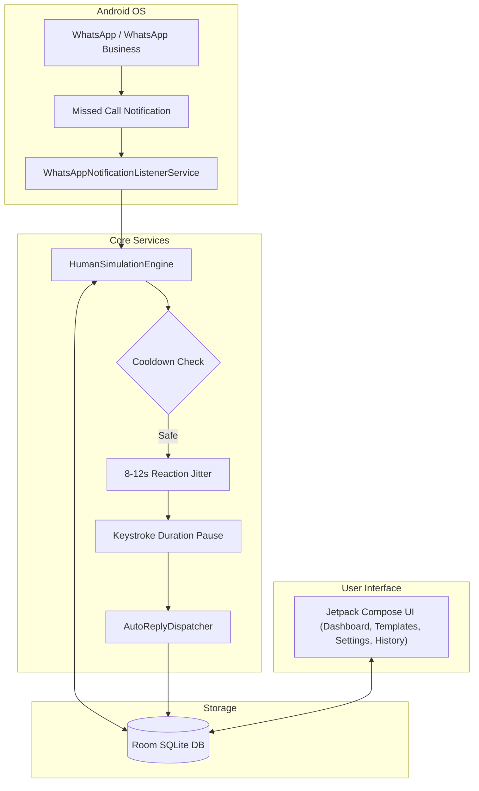

# System Architecture

## Component Overview

The application follows Android MVVM architecture powered by Jetpack Compose and Room Persistence:

## Core Modules

1. **`WhatsAppNotificationListenerService`**:
   Binds to Android's notification subsystem and filters for `com.whatsapp` and `com.whatsapp.w4b` missed call notifications.

2. **`HumanSimulationEngine`**:
   Orchestrates delays, typing pauses, and manual cancellation safeguards.

3. **`AutoReplyDispatcher`**:
   Extracts `RemoteInput` from notification actions to deliver responses back into WhatsApp.

4. **`AppDatabase`**:
   Stores active templates, system settings, and an audit trail of all intercepted calls.
